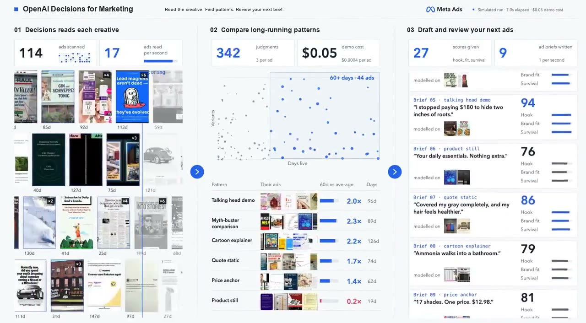

# OpenAI Decisions for Marketing

**OpenAI Decisions makes ad research feel like cheating.** Turn creative images, ad copy and sampled video frames into a searchable research library, pattern comparisons and original briefs.

[](https://novitckii.com/lib/openai-decisions-marketing/demo-light.mp4)

[Watch the demo](https://novitckii.com/lib/openai-decisions-marketing/demo-light.mp4) · [Full resource guide](https://novitckii.com/resources/openai-decisions-marketing/) · [Setup](docs/SETUP.md) · [Validation](docs/VALIDATION.md)

An OpenAI Decisions edition of [Ad Pattern Lab](https://github.com/artemnovitckii/ad-pattern-lab). The default real classifier receives **image pixels**, alongside available copy and speech, using the dedicated `POST /v1/decisions` endpoint and `gpt-6-luna`.

## Start with no keys

Install Node.js 22.9 or newer:

```sh
git clone https://github.com/artemnovitckii/openai-decisions-marketing.git
cd openai-decisions-marketing
npm ci
npm run setup
npm start
```

Open **http://127.0.0.1:5194/**. The light research app opens on a completed sample report. Filter format and hook, click a thumbnail or map point, explore the findings, and open the linked briefs. Press **Replay demo run** to animate the wall and map together.

The included demo needs no keys and makes no AI calls. It uses fictional copy, dates, labels, grouping and scores. The optional public image pack supplies inspiration artwork, not verified campaign results. The 20-second video above reuses the original interface animation with OpenAI branding; its numbers and rubric scores are illustrative, not a paid Decisions run or benchmark.

For the wide recording layout:

```text
http://127.0.0.1:5194/variations.html?variant=reference&clean=1&duration=20
```

## Analyze five real ads

Install FFmpeg and ffprobe, then add your key to the local `.env`:

```dotenv
OPENAI_API_KEY=your_openai_key
ANALYSIS_PROVIDER=openai
PORT=5194
```

Restart. Choose **Import ads**, upload five static creative images, then click **Analyze / retry unfinished**. No Apify or speech key is needed for static image uploads.

For videos, the app samples up to four timestamped frames. Optional Fireworks or Groq adds speech:

```dotenv
TRANSCRIPTION_PROVIDER=fireworks
FIREWORKS_API_KEY=your_fireworks_key
# Or TRANSCRIPTION_PROVIDER=groq and GROQ_API_KEY=your_groq_key
```

Click a creative, then **All labels & evidence** to see the actual submitted images, frame timestamps, provider, model, confidence, copy and available transcript. Four frames are not a complete video inspection.

## What Decisions classifies

| Dimension | What it helps you study |
| --- | --- |
| Format | Creator demo, product, testimonial, comparison, founder, graphic |
| Hook | Problem, result, curiosity, contradiction, offer, direct introduction |
| Angle | Convenience, performance, price, trust, experience, identity |
| Offer | Discount, bundle, subscription, trial, guarantee, none |
| Proof | Demonstration, testimonial, comparison, numbers, named source |
| Objection | Price, trust, effort, effectiveness, suitability |
| CTA | Buy, learn, signup, book, message, none |

Seven named choice questions share the same evidence. Dates and active status are joined afterward, not supplied to the classifier. Missing evidence can return `unknown`; confidence is not the likelihood an ad will sell.

## Collect from the Meta Ad Library

Add `APIFY_TOKEN` to `.env`. Choose **Meta collection**, supply public Ad Library or Facebook page URLs, and start with a small batch and cap. Collection and AI analysis are separate buttons. The Apify connector is implemented but has not had a paid live validation run. An uncertain launch should be checked and attached by run ID instead of started again.

You can also import an existing JSON export or local files. JSON and pasted-copy imports replace the saved batch; uploads append. Export your current batch first.

## Turn patterns into briefs

The map shows exact creative families by age since reported start and observed ad-ID count. The table compares **active ads aged 60+ days / dated active ads**. Findings report those figures and suggest original tests. Age is not continuous delivery, profit, CTR, CPA or ROAS. An active snapshot cannot measure survival odds.

Supply your own audience, product facts and actual offer under **Your product → original briefs**. With no writer, you get editable outlines. An optional compatible text model writes drafts; Decisions separately scores clarity, brand fit and claim support. **Decisions does not generate prose or transcribe audio.** Review scores are rubric judgments, not performance forecasts.

## Optional image pack

The starter includes 16 generated fictional reference images. For a larger demo wall:

```sh
npm run demo:download
# Or use your local images:
npm run demo:images -- /path/to/images
```

Install FFmpeg first. Public examples come from Swipefile and can include print and other marketing creatives, not only Meta ads. They stay in your ignored local cache. [Image sources](docs/IMAGE-SOURCES.md).

## Costs, keys and verification

The documented Decisions base rate is $0.10 per million input tokens, with no output-token charge. The app estimates known usage; regional/long-context premiums, collection, speech and writing are excluded. No measured total-cost or speed claim is made here. [Official Decisions documentation](https://developers.openai.com/api/docs/guides/decisions).

Keys stay server-side in `.env`. Local uploads and caches live in ignored `data/`. The public repository includes no keys, user uploads, real local batch or downloaded inspiration image pack. [Data flow](docs/PRIVACY.md).

```sh
npm run doctor
npm run check
npm test
```

The implementation has passed local FFmpeg image/video processing and mocked Decisions integration tests. A paid Decisions or Apify end-to-end run remains unverified. [Exact validation status](docs/VALIDATION.md).

Built by [Artem Novitckii](https://novitckii.com). Independent of OpenAI, Meta and Apify. MIT code license. Bundled generated artwork depicts fictional campaigns. Legacy Jev is optional via `ANALYSIS_PROVIDER=jev`; OpenAI is the default.
